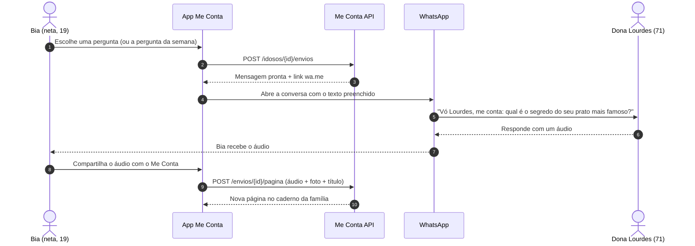
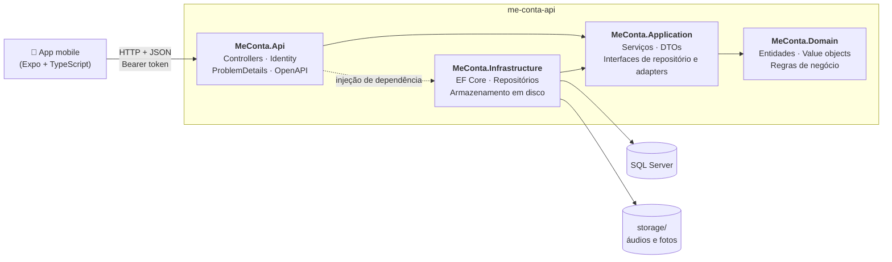
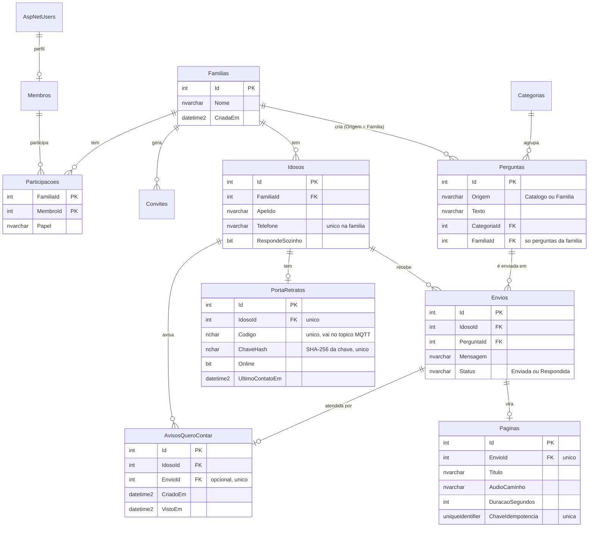

# Me Conta · API

### Integrantes

| Nome             | RM        | Turma |
| ---------------- | --------- | ----- |
| Nicoli Amy Kassa | RM 559104 | 3ESPW |

---

<br>

> O app que troca o 👍 da família por uma pergunta que só os avós sabem responder.

Backend do **Me Conta**, desenvolvido para a Global Solution FIAP 2026 (CitizenTech). Uma única Web API em **C# / .NET 10** é o centro da solução: atende **C# Software Development** e **SOA e Web Services**, recebe o porta-retrato de **Physical Computing (IoT)** e o módulo de privacidade de **Cybersecurity**, e é a aplicação que roda no servidor de **Operating Systems**. Ela guarda famílias, idosos, perguntas e o caderno de memórias da família, e é consumida pelo app mobile (Expo).

|                            |                                                                   |
| -------------------------- | ----------------------------------------------------------------- |
| 🎬 **Pitch**               | [**Assistir no YouTube**](https://youtu.be/INSERIR-LINK-DO-PITCH) |
| 📄 **Documentação da API** | `/swagger` e `/scalar` (com a API rodando)                        |
| 🧪 **Testes**              | `dotnet test` (354 testes)                                        |
| 🗂️ **Matérias**            | [O que cada matéria faz e onde cada entrega está](docs/MATERIAS.md) |
| 🖼️ **Porta-retrato (IoT)** | [Circuito no Wokwi, ponte Node-RED e evidências](iot/README.md)     |
| 🛡️ **Privacidade (Cyber)** | [Motor de PII, taint analysis, IA e painel Risco Cidadão](docs/cyber/README.md) |
| 🐧 **Servidor Linux (OS)** | [Provisionamento, monitoramento e auditoria](linux/README.md) |

---

## Ficha da CitizenTech

| Campo                     | Resposta                                                                                                                                                                                                                                                                                                                                   |
| ------------------------- | ------------------------------------------------------------------------------------------------------------------------------------------------------------------------------------------------------------------------------------------------------------------------------------------------------------------------------------------ |
| **Nome da CitizenTech**   | Me Conta                                                                                                                                                                                                                                                                                                                                   |
| **Cidade e bairro**       | São Paulo (SP). Bairro piloto: Pirituba, zona norte                                                                                                                                                                                                                                                                                        |
| **Cidadão beneficiado**   | Pessoas idosas, com mais de 60 anos, especialmente as que moram sozinhas, e seus netos e filhos. Pelo modo "Ensine sua avó", também os idosos que ainda não usam o celular.                                                                                                                                                                |
| **Problema em uma frase** | Os avós guardam receitas, histórias da família e memórias do bairro que ninguém mais tem, mas, quando mandam um "bom dia" no grupo da família, recebem de volta um 👍 e nenhuma pergunta.                                                                                                                                                  |
| **A solução**             | O Me Conta é um aplicativo que troca o 👍 da família por uma pergunta que só os avós sabem responder.                                                                                                                                                                                                                                      |
| **Como funciona**         | O neto escolhe uma pergunta no app (receitas, história da família, ofícios, o bairro, conselhos). O app abre o WhatsApp com a mensagem pronta. O avô responde por áudio, do jeito que já sabe. A resposta vira uma memória, e vai para a página do caderno da família, com áudio, foto e título. O idoso volta a ser quem ensina e lembra. |
| **Link do repositório**   | [Me Conta API - GitHub](https://github.com/Nicoli-Kassa/GS_CitizenTech_API_MeConta)                                                                                                                                                                                                                                                        |
| **Indicador de impacto**  | Conversas de verdade por semana: % de idosos que respondem pelo menos uma pergunta da família por semana. Indicadores de apoio: minutos de áudio guardados no caderno de cada família e % de idosos que passam a responder sem ajuda depois do modo "Ensine sua avó".                                                                      |
| **ODS conectados**        | **ODS 10**, meta 10.2 (inclusão social de todos, independentemente da idade) · **ODS 11**, meta 11.4 (proteger o patrimônio cultural, aqui a memória do bairro) · **ODS 3**, meta 3.4 (bem-estar mental, pelo vínculo e não por cuidado de saúde)                                                                                          |

---

## Sumário

1. [O problema](#o-problema)
2. [A solução](#a-solução)
3. [Contribuição para os ODS](#contribuição-para-os-ods)
4. [Matérias atendidas por esta API](#matérias-atendidas-por-esta-api)
5. [O que esta API faz](#o-que-esta-api-faz)
6. [Arquitetura](#arquitetura)
7. [Modelo de domínio e POO](#modelo-de-domínio-e-poo)
8. [Banco de dados e migrações](#banco-de-dados-e-migrações)
9. [Endpoints](#endpoints)
10. [Regras de negócio](#regras-de-negócio)
11. [Como executar](#como-executar)
12. [Testes automatizados](#testes-automatizados)
13. [Evidências](#evidências)
14. [Privacidade e segurança](#privacidade-e-segurança)
15. [Tecnologias](#tecnologias)
16. [Próximos passos](#próximos-passos)

---

## O problema

Pense na sua avó. Ela sabe de cor a receita do bolo de domingo, lembra como era o bairro quando a rua ainda era de terra e guarda histórias da família que mais ninguém conhece. Toda manhã, ela manda um "bom dia" no grupo da família. A resposta, quando vem, é um 👍.

Antes, falar com quem morava longe custava caro. Cada minuto de ligação pesava na conta de telefone, e por isso era bem usado. Hoje, a avó está a um clique de distância, de graça, a qualquer hora. E a conversa encolheu até caber num emoji.

**Não é falta de amor. É falta de assunto.** A família quer estar perto, mas não sabe o que dizer além de um 👍. Do outro lado, fica alguém com uma vida inteira para contar, esperando uma pergunta que não chega.

| Dado                                                                                                                       | Fonte                                                                       |
| -------------------------------------------------------------------------------------------------------------------------- | --------------------------------------------------------------------------- |
| **32,1 milhões** de pessoas com 60 anos ou mais no Brasil                                                                  | IBGE, Censo 2022                                                            |
| **5,7 milhões** de idosos moram sozinhos                                                                                   | IBGE, Censo 2022                                                            |
| A solidão está associada a cerca de **871 mil mortes por ano**, perto de **100 por hora**, e afeta **1 em cada 6 pessoas** | OMS, Comissão de Conexão Social (jun/2025)                                  |
| **9,1 milhões** de idosos brasileiros não usam a internet; **66,5%** deles porque não sabem usar                           | IBGE, PNAD Contínua TIC 2025 (9,1 mi = cálculo próprio sobre os microdados) |
| **4,9 milhões** desses idosos desconectados moram com alguém que usa a internet                                            | Cálculo próprio sobre os microdados da PNAD TIC 2025                        |
| O contato digital **complementa**, mas não substitui, o contato presencial                                                 | Fu et al., 2023                                                             |

Existe ainda uma perda silenciosa. Cada história que ninguém pergunta é uma história que um dia vai embora com quem a viveu: a receita que nunca foi anotada, o nome antigo da rua, o jeito como a família começou. Quando alguém finalmente pensar em perguntar, pode ser tarde demais.

## A solução

**Se falta assunto, o Me Conta tem de monte.**

O Me Conta troca o 👍 por uma pergunta que só a avó sabe responder: _"Vó, qual era o segredo do seu bolo de domingo?"_, _"Como era o bairro quando a senhora chegou?"_, _"Qual foi o melhor conselho que a senhora já recebeu?"_

A Bia, de 19 anos, abre o app e escolhe uma pergunta. Com um toque, a pergunta abre no WhatsApp da Dona Lourdes, pronta para enviar. A Dona Lourdes não precisa baixar nada nem aprender nada novo: responde com um áudio, como sempre fez. Esse áudio vira uma página do caderno da família, com título, foto e a voz dela, guardada para os netos, os bisnetos e quem vier depois.



O Me Conta cresce em três degraus:

| Degrau            | O que faz                                                                                            | Situação no protótipo                                    |
| ----------------- | ---------------------------------------------------------------------------------------------------- | -------------------------------------------------------- |
| **1. Conectar**   | O modo "Ensine sua avó" transforma o neto em professor, passo a passo, até o primeiro áudio enviado. | API registra quem concluiu o roteiro (`RespondeSozinho`) |
| **2. Aprofundar** | O coração do app: a pergunta, a resposta e o caderno da família.                                     | **Funciona de ponta a ponta**                            |
| **3. Expandir**   | Com permissão e após um filtro de dados pessoais, memórias vão para o mapa do bairro.                | Visão de futuro                                          |

O Me Conta não substitui a visita de domingo. O objetivo é que, na próxima visita, a família tenha muito mais assunto.

## Contribuição para os ODS

| ODS                                        | Meta                                                                   | Como o Me Conta contribui                                                                                                     |
| ------------------------------------------ | ---------------------------------------------------------------------- | ----------------------------------------------------------------------------------------------------------------------------- |
| **10. Redução das desigualdades**          | 10.2 · Promover a inclusão social de todos, independentemente da idade | Coloca o idoso no centro da conversa da família como quem ensina, e o modo "Conectar" ajuda quem ainda está fora da internet. |
| **11. Cidades e comunidades sustentáveis** | 11.4 · Proteger o patrimônio cultural                                  | Guarda receitas, ofícios e memórias do bairro que hoje se perdem por falta de registro.                                       |
| **3. Saúde e bem-estar**                   | 3.4 · Promover a saúde mental e o bem-estar                            | Atua pelo vínculo: mais conversa de verdade e menos isolamento, sem ser um app de saúde.                                      |

---

## Matérias atendidas por esta API

Cada matéria cuida de uma parte do Me Conta. O mapa completo, com cada critério de entrega ligado ao arquivo que o atende, está em **[docs/MATERIAS.md](docs/MATERIAS.md)**.

| Matéria | A parte dela no Me Conta | Onde está nesta API |
| --- | --- | --- |
| **C# Software Development** | A Web API inteira, com domínio orientado a objetos, EF Core, LINQ e async/await | `src/` (4 projetos) e `tests/` · [detalhes](docs/MATERIAS.md#c-software-development) |
| **SOA e Web Services** | Os serviços REST que o app e o porta-retrato consomem, com banco, migrações, documentação automática e testes | `src/`, `Migrations/`, `/swagger`, `/scalar`, `tests/` · [detalhes](docs/MATERIAS.md#soa-e-web-services) |
| **Physical Computing (IoT)** | Porta-retrato com ESP32 que acende com pergunta nova e tem o botão "quero contar" | Pasta [`iot/`](iot/README.md) (circuito, firmware, ponte Node-RED e painel); rotas `/porta-retrato/*` e `/avisos`, migração `PortaRetrato` · [detalhes](docs/MATERIAS.md#physical-computing-iot) |
| **Cybersecurity** | Filtro de dados pessoais, taint analysis, tradução dos riscos com IA e painel "Risco Cidadão" antes de publicar no mapa do bairro | Proteções em [Privacidade e segurança](#privacidade-e-segurança); motor de PII `MeConta.Privacidade` ([como funciona](docs/cyber/motor-pii.md)), [taint analysis](docs/cyber/taint-analysis.md) com Semgrep e TruffleHog no GitHub Actions, [IA na remediação e painel](docs/cyber/remediacao-ia.md) em `/risco-cidadao/` · [detalhes](docs/MATERIAS.md#cybersecurity) |
| **Operating Systems** | Servidor Linux que roda esta API, com monitoramento e logs | Pasta [`linux/`](linux/README.md) (provisionamento em Bash, systemd, monitor, auditoria, teste de falha) · [detalhes](docs/MATERIAS.md#operating-systems) |
| **Testing, Compliance & QA** | Backlog e casos de teste no Azure DevOps | Coluna "User story" dos [Endpoints](#endpoints) e [roteiro de testes](docs/ROTEIRO_DE_TESTES.md) · [detalhes](docs/MATERIAS.md#testing-compliance--qa) |
| **Mobile** | App Expo da neta: perguntar, enviar e montar o caderno | Consome esta API; idempotência para o modo offline · [detalhes](docs/MATERIAS.md#mobile) |
| **IA & ML** | Modelo com dados reais da PNAD TIC sobre idosos desconectados | Fora desta API: [repositório próprio](https://github.com/Nicoli-Kassa/GS_CitizenTech_IA-ML_MeConta) |

## O que esta API faz

- Cadastro de **famílias**, **membros** (neta, filha) e **idosos**, com entrada de parentes por **código de convite** de 48 horas.
- **Catálogo de 25 perguntas** em 5 categorias, **pergunta da semana** para cada idoso e **perguntas próprias** da família, com **filtro anti-golpe** (bloqueia pedidos de PIX, dinheiro, senha ou código).
- **Envio pelo WhatsApp**: registra o envio e devolve a mensagem pronta e o link `wa.me`, com acentos e emojis codificados.
- **Caderno da família**: upload do áudio da resposta (e foto opcional), listagem paginada com filtros, áudio para ouvir no app e exclusão pela pessoa que criou a página.
- **Modo offline**: o app manda uma chave de idempotência; se reenviar a mesma página, a API devolve a que já existe e não duplica.
- **Indicador de impacto** "Conversas de verdade" da semana.
- **Porta-retrato Me Conta (IoT)**: pareamento de uma caixinha com ESP32 ao idoso; a caixinha (pela ponte Node-RED) consulta se há pergunta esperando, avisa "quero contar" e informa se está conectada, usando uma chave própria no lugar do login. A família vê os avisos no app. O circuito no Wokwi, o firmware e a ponte Node-RED estão na pasta [`iot/`](iot/README.md).
- **Login** com ASP.NET Identity (token Bearer) e regra de acesso: só a família vê os dados da família.

## Arquitetura

A solução segue uma arquitetura em camadas, com a regra de dependência garantida pelo compilador: cada camada é um projeto e só referencia as camadas internas.



| Projeto                  | Responsabilidade                                                                                                                                                            | Depende de                  |
| ------------------------ | --------------------------------------------------------------------------------------------------------------------------------------------------------------------------- | --------------------------- |
| `MeConta.Domain`         | Entidades, value objects, exceções e regras de negócio puras. Nenhum pacote externo.                                                                                        | —                           |
| `MeConta.Application`    | Casos de uso (serviços), DTOs e as interfaces que a infraestrutura implementa (`IRepository<T,TId>`, `IUnidadeDeTrabalho`, `IArmazenamentoDeArquivos`, `IUsuarioAtual`...). | Domain, Privacidade         |
| `MeConta.Infrastructure` | `AppDbContext` (EF Core + Identity), configurações Fluent API, migrações, repositórios, consultas LINQ e adapters de disco e de código de convite.                          | Application                 |
| `MeConta.Api`            | Controllers REST, autenticação, tratamento de erros, documentação OpenAPI, health check e composição da injeção de dependência.                                             | Application, Infrastructure |
| `MeConta.Privacidade`    | Motor de dados pessoais (PII): regras em JSON, validadores, índice Risco Cidadão e os tipos que separam texto não verificado de texto verificado ([como funciona](docs/cyber/motor-pii.md)). Nenhum pacote externo. | —                           |

```
GS_CitizenTech_API_MeConta/
├── .github/workflows/
│   └── seguranca.yml            ← pipeline de segurança: Semgrep (taint), TruffleHog e testes
├── README.md
├── prompts.md
├── MeConta.slnx
├── Directory.Build.props        ← net10.0, nullable, implicit usings
├── docs/
│   ├── MATERIAS.md              ← o que cada matéria faz e onde cada entrega está
│   ├── ROTEIRO_DE_TESTES.md     ← 117 passos com o resultado esperado
│   ├── cyber/                   ← motor de PII, taint analysis, IA na remediação e painel
│   └── evidencias/              ← prints usados neste README
├── iot/                         ← porta-retrato: circuito no Wokwi, firmware, ponte Node-RED e prints
├── seguranca/
│   ├── semgrep/                 ← regras de taint analysis e de segredos, com casos de teste
│   ├── relatorios/              ← auditoria do protótipo: antes e depois das correções
│   └── demo/                    ← simular-atividade.ps1: movimento no painel para o vídeo
├── src/
│   ├── MeConta.Domain/          Comum · Entidades · Enums · Excecoes · Regras · ValueObjects
│   ├── MeConta.Application/     Abstracoes · Adapters · Auditoria · Dtos · Excecoes · Servicos
│   ├── MeConta.Infrastructure/  Adapters · Ia (Gemini) · Persistencia (Configuracoes, Migrations) · Repositorios
│   ├── MeConta.Api/             Adapters · Configuracao · Controllers · wwwroot (painel) · Program.cs · MeConta.Api.http
│   └── MeConta.Privacidade/     Motor · Normalizacao · Regras (regras-pii.json) · Resultados · Taint · Validadores
├── tools/
│   └── MeConta.Privacidade.Avaliacao/  ← tabela de precisão e recall do motor de PII
└── tests/
    └── MeConta.UnitTests/       Domain · Privacidade · Regras · Remediacao · Servicos
```

## Modelo de domínio e POO

```mermaid
classDiagram
    direction LR
    class Entidade {
        <<abstract>>
        +int Id
    }
    class IPergunta {
        <<interface>>
        +VisivelPara(familiaId) bool
    }
    class Pergunta {
        <<abstract>>
        +string Texto
        +int CategoriaId
        +VisivelPara(familiaId)* bool
    }
    class PerguntaCatalogo {
        +VisivelPara(familiaId) bool
    }
    class PerguntaDaFamilia {
        +int FamiliaId
        +VisivelPara(familiaId) bool
    }
    class ArquivoDeMidia {
        <<abstract>>
        +string Extensao
        +string ContentType
        +Pasta()* string
    }
    class Familia {
        +EhMembro(membroId) bool
        +GerarConvite() Convite
        +AceitarConvite()
        +CadastrarIdoso() Idoso
    }
    class EnvioPergunta {
        +string Mensagem
        +ObterLinkWhatsApp() string
        +Responder() PaginaCaderno
    }

    Entidade <|-- Familia
    Entidade <|-- Pergunta
    Entidade <|-- EnvioPergunta
    IPergunta <|.. Pergunta
    Pergunta <|-- PerguntaCatalogo
    Pergunta <|-- PerguntaDaFamilia
    ArquivoDeMidia <|-- ArquivoDeAudio
    ArquivoDeMidia <|-- ArquivoDeFoto
    Familia "1" *-- "*" Idoso
    Familia "1" *-- "*" Convite
    Familia "1" *-- "*" Participacao
    Idoso "1" -- "*" EnvioPergunta
    EnvioPergunta "1" -- "0..1" PaginaCaderno
```



| Pilar                                   | Onde aparece                                                                                                                                                                                                                    |
| --------------------------------------- | ------------------------------------------------------------------------------------------------------------------------------------------------------------------------------------------------------------------------------- |
| **Abstração**                           | `IPergunta`, `Pergunta` e `ArquivoDeMidia` são abstratas; serviços dependem de interfaces (`IFamiliaService`, `IPaginaRepository`...).                                                                                          |
| **Herança**                             | `Entidade` → todas as entidades; `Pergunta` → `PerguntaCatalogo` / `PerguntaDaFamilia`; `ArquivoDeMidia` → `ArquivoDeAudio` / `ArquivoDeFoto`; `RegraDeNegocioException` → `ConflitoException` / `ArquivoMuitoGrandeException`. |
| **Polimorfismo**                        | `VisivelPara(familiaId)`: o catálogo é visível para todos, a pergunta da família só para ela. Cada tipo de arquivo define formatos, limite e mensagens (template method no construtor da classe base).                          |
| **Encapsulamento**                      | Setters privados, construtores que validam, coleções expostas como `IReadOnlyCollection`. Só a `Familia` cadastra idosos (garante o WhatsApp único) e só o `EnvioPergunta` cria páginas (garante uma resposta por pergunta).    |
| **Value objects**                       | `Telefone` (normaliza para 55 + DDD + número), `Semana` (segunda a domingo, no fuso de Brasília).                                                                                                                               |
| **Interfaces e injeção de dependência** | Repositórios, serviços, `IFiltroAntiGolpe`, `ISugestaoSemanal`, `IArmazenamentoDeArquivos`, `IGeradorDeCodigoConvite`, `IUsuarioAtual` e `TimeProvider` (relógio injetável), todos registrados no contêiner do ASP.NET Core.    |

## Banco de dados e migrações

- **SQL Server** com Entity Framework Core 10 (LocalDB no desenvolvimento).
- As tabelas do login (`AspNetUsers`...) vêm do ASP.NET Identity, no mesmo `AppDbContext`.
- **Fluent API** em `Persistencia/Configuracoes`: tamanhos, chaves, índices únicos, enums gravados como texto, conversores de valor e regras de exclusão.
- **Herança TPH**: as duas perguntas ficam na tabela `Perguntas`, separadas pela coluna `Origem`.
- **Seed na migração** (`HasData`): 5 categorias e 25 perguntas.
- **Migrações** aplicadas automaticamente ao subir a API (`MigrateAsync`).
- **LINQ** nas duas sintaxes: consulta (`from ... join ... select`) nas famílias do membro e no indicador; métodos (`Where`, `Include`, `OrderByDescending`, `Skip/Take`, `SumAsync`) no caderno paginado.
- Todo o acesso ao banco é **assíncrono** (`async/await` com `CancellationToken` do controller até o EF Core).



## Endpoints

Todas as rotas ficam em `/api/v1` e, exceto login, cadastro, categorias e as rotas do aparelho (porta-retrato), exigem o token Bearer. As rotas do aparelho usam a chave do porta-retrato no cabeçalho `X-Chave-PortaRetrato`. Os erros seguem o padrão **ProblemDetails** (RFC 9457), com a mensagem pronta para o app mostrar no campo `detail`.

| Método              | Rota                                                                 | User story    | Respostas                   |
| ------------------- | -------------------------------------------------------------------- | ------------- | --------------------------- |
| POST                | `/auth/register` · `/auth/login`                                     | Login         | 200 · 400 · 401             |
| POST                | `/membros`                                                           | Perfil        | 201 · 400 · 409             |
| GET                 | `/membros/eu`                                                        | Perfil        | 200 · 403                   |
| POST                | `/familias`                                                          | US01          | 201 · 400                   |
| GET                 | `/familias` · `/familias/{familiaId}`                                | US01          | 200 · 403 · 404             |
| POST                | `/familias/{familiaId}/convites`                                     | US03          | 201 · 403                   |
| POST                | `/convites/{codigo}/aceitar`                                         | US03          | 200 · 400                   |
| POST · GET          | `/familias/{familiaId}/idosos`                                       | US02          | 201 · 200 · 400 · 409       |
| GET · PUT           | `/idosos/{idosoId}`                                                  | US02          | 200 · 400 · 403 · 404 · 409 |
| POST                | `/idosos/{idosoId}/roteiro-concluido`                                | US14          | 200                         |
| GET                 | `/categorias`                                                        | US04          | 200                         |
| GET                 | `/idosos/{idosoId}/perguntas?categoria=`                             | US04          | 200 · 404                   |
| GET                 | `/idosos/{idosoId}/pergunta-da-semana`                               | US05          | 200 · 204                   |
| POST                | `/familias/{familiaId}/perguntas`                                    | US06          | 201 · 400                   |
| POST · GET          | `/idosos/{idosoId}/envios`                                           | US07          | 201 · 200 · 404 · 409       |
| POST                | `/envios/{envioId}/pagina` (multipart)                               | US08 · US10   | 201 · 200 · 400 · 409 · 413 |
| GET                 | `/familias/{familiaId}/caderno?idosoId=&categoria=&pagina=&tamanho=` | US09          | 200 · 403                   |
| GET                 | `/paginas/{paginaId}` · `/audio` · `/foto`                           | US09          | 200 · 403 · 404             |
| DELETE              | `/paginas/{paginaId}`                                                | US11          | 204 · 403                   |
| GET                 | `/indicadores/conversas-de-verdade?data=`                            | US12          | 200                         |
| POST · GET · DELETE | `/idosos/{idosoId}/porta-retrato`                                    | US15          | 201 · 200 · 204 · 403 · 404 |
| GET                 | `/porta-retrato/estado` (chave do aparelho)                          | US15          | 200 · 401                   |
| POST                | `/porta-retrato/quero-contar` (chave do aparelho)                    | US15          | 201 · 200 · 400 · 401       |
| PUT                 | `/porta-retrato/conexao` (chave do aparelho)                         | US15          | 204 · 401                   |
| GET                 | `/familias/{familiaId}/avisos?somenteNaoVistos=`                     | US15          | 200 · 403                   |
| POST                | `/avisos/{avisoId}/visto`                                            | US15          | 200 · 403 · 404             |
| PUT                 | `/paginas/{paginaId}/transcricao`                                    | US18          | 200 · 400 · 403             |
| POST                | `/paginas/{paginaId}/analise-privacidade`                            | US18          | 200 · 403 · 404             |
| POST · DELETE       | `/paginas/{paginaId}/publicacao`                                     | US16 · US18   | 201 · 204 · 400 · 409 · 422 |
| GET                 | `/bairros/{bairro}/memorias` (sem login)                             | US17          | 200                         |
| GET                 | `/memorias/{memoriaId}/audio` (sem login)                            | US17          | 200 · 404                   |
| GET                 | `/risco-cidadao?dias=` (sem login, só números e trechos mascarados)  | US18          | 200 · 400 · 429             |
| GET                 | `/paginas/{paginaId}/explicacao-de-risco` (IA, só dados mascarados)  | US18          | 200 · 403 · 404 · 429       |
| GET                 | `/risco-cidadao/alertas?dias=` (sem login, alertas traduzidos)       | US18          | 200 · 400 · 429             |
| GET                 | `/risco-cidadao/auditoria` (sem login, Semgrep traduzido)            | US18          | 200 · 404 · 429             |
| GET                 | `/health`                                                            | Monitoramento | 200 · 503                   |

## Regras de negócio

| Regra                                                                                     | Onde fica                               | Resposta                                                 |
| ----------------------------------------------------------------------------------------- | --------------------------------------- | -------------------------------------------------------- |
| Nome da família obrigatório, até 60 caracteres                                            | `Familia`                               | 400 "Dê um nome para a família"                          |
| WhatsApp com DDD, salvo como 55 + DDD + número                                            | `Telefone`                              | 400 "Confira o número do WhatsApp"                       |
| O mesmo WhatsApp não se repete na família                                                 | `Familia` + índice único                | 409 "Esse número já está na família"                     |
| Convite com 6 caracteres, válido por 48 horas                                             | `Convite`                               | 400 "Código inválido ou expirado. Peça um novo."         |
| Pergunta da família com 10 a 200 caracteres, sem pedido de PIX, dinheiro, senha ou código | `PerguntaDaFamilia` + `FiltroAntiGolpe` | 400 "O Me Conta não envia pedidos de dinheiro ou senhas" |
| Pergunta da semana muda toda segunda e nunca repete uma já enviada                        | `SugestaoSemanal` + `Semana`            | 204 quando o catálogo acabou                             |
| Sem WhatsApp cadastrado, não há envio                                                     | `EnvioPergunta`                         | 409 "Cadastre o WhatsApp"                                |
| Áudio mp3, m4a, ogg ou opus, até 20 MB; foto até 10 MB                                    | `ArquivoDeAudio` · `ArquivoDeFoto`      | 400 · 413                                                |
| Uma resposta por pergunta enviada                                                         | `EnvioPergunta.Responder`               | 409 "Essa pergunta já foi respondida"                    |
| Mesma chave de idempotência não duplica a página                                          | `CadernoService` + índice único         | 200 com a página existente                               |
| Só a família vê o caderno; só quem criou apaga a página                                   | `ControleDeAcesso` · `PaginaCaderno`    | 403                                                      |
| Indicador sem idosos cadastrados não divide por zero                                      | `IndicadorService`                      | 200 "Ainda não há dados"                                 |
| Nada vai para o mapa do bairro sem a autorização da pessoa idosa                          | `MemoriaDoBairro`                       | 400 "Marque que Vó Lourdes autorizou..."                 |
| Dado de risco alto (CPF, senha, cartão, conta, PIX, código) bloqueia a publicação         | `PrivacidadeService` + motor de PII     | 422 com a análise mascarada                              |
| Dado de risco médio (saúde, telefone, endereço, rotina) só vai com a confirmação          | `CamposVerificados` + motor de PII      | 422 até `confirmoDadosPessoais` = `true`                 |
| O bairro é só o nome do bairro, nunca endereço                                            | `PrivacidadeService` + motor de PII     | 400 "Use só o nome do bairro..."                         |
| Cada página aparece no mapa no máximo uma vez; tirar do mapa é imediato                   | `MemoriaDoBairro` + índice único        | 409 · 204                                                |

## Como executar

### Pré-requisitos

- [.NET 10 SDK](https://dotnet.microsoft.com/download)
- SQL Server LocalDB (vem com o Visual Studio, componente "SQL Server Express LocalDB") ou outro SQL Server
- Ferramenta do EF Core: `dotnet tool install --global dotnet-ef`

### Passo a passo

```powershell
# 1. Clonar
git clone https://github.com/Nicoli-Kassa/GS_CitizenTech_API_MeConta.git
cd GS_CitizenTech_API_MeConta

# 2. Compilar e rodar os testes
dotnet build
dotnet test

# 3. Subir a API (cria o banco, aplica as migrações e o catálogo de perguntas)
dotnet run --project src/MeConta.Api --launch-profile http
```

Com a API no ar:

| Endereço                              | O que é                 |
| ------------------------------------- | ----------------------- |
| http://localhost:5080/swagger         | Swagger UI              |
| http://localhost:5080/scalar          | Scalar                  |
| http://localhost:5080/openapi/v1.json | Documento OpenAPI       |
| http://localhost:5080/health          | Saúde da API e do banco |
| http://localhost:5080/risco-cidadao/  | Painel Risco Cidadão    |

Para usar outro SQL Server, troque `ConnectionStrings:DefaultConnection` em `src/MeConta.Api/appsettings.json` ou use a variável de ambiente `ConnectionStrings__DefaultConnection`. Para o app no celular acessar a API pela rede local, use `--launch-profile rede-local` (escuta em `0.0.0.0:5080`).

### Chave do Gemini (opcional)

A tradução dos riscos usa o Gemini no plano gratuito. Sem chave, a API funciona igual e usa as explicações escritas pela equipe ([como funciona](docs/cyber/remediacao-ia.md)).

1. Entre em [aistudio.google.com](https://aistudio.google.com) com uma conta Google e clique em **Get API key** → **Create API key**.
2. Guarde a chave no user-secrets, fora do repositório (nunca no `appsettings.json`):

```powershell
dotnet user-secrets set "Gemini:ChaveApi" "<sua chave>" --project src\MeConta.Api
```

3. Suba a API de novo. Em `GET /api/v1/risco-cidadao/alertas`, o campo `fonte` passa a mostrar `Gemini (...)`.

### Dados de demonstração

No ambiente de desenvolvimento, a API cria dados **fictícios** baseados nas personas do projeto:

| Quem                | Login                                  | Papel                                                    |
| ------------------- | -------------------------------------- | -------------------------------------------------------- |
| Bia (19, neta)      | `bia@example.com` / `MeConta@2026`     | Criou a Família Souza                                    |
| Cláudia (45, filha) | `claudia@example.com` / `MeConta@2026` | Entrou pelo convite `CASA26`                             |
| Vó Lourdes (71)     | —                                      | Idosa com WhatsApp fictício, já com uma pergunta enviada |
| Vô Antônio (78)     | —                                      | Idoso sem WhatsApp (degrau "Conectar")                   |

### Testando pelo Swagger

1. Em `POST /api/v1/auth/login`, envie `{"email": "bia@example.com", "password": "MeConta@2026"}`.
2. Copie o `accessToken`, clique em **Authorize** e cole o token.
3. Chame os endpoints.

O **[roteiro de testes](docs/ROTEIRO_DE_TESTES.md)** traz 117 passos, cobrindo todas as requisições, inclusive as do porta-retrato e as do filtro de dados pessoais, com o resultado esperado de cada uma (casos de sucesso e de erro). As mesmas chamadas estão prontas para rodar no Visual Studio em [`src/MeConta.Api/MeConta.Api.http`](src/MeConta.Api/MeConta.Api.http); o envio de áudio é feito pelo Swagger.

### Recriar a migração (se mudar o modelo)

```powershell
dotnet ef migrations add NomeDaMudanca -p src/MeConta.Infrastructure -s src/MeConta.Api -o Persistencia/Migrations
```

## Testes automatizados

```powershell
dotnet test
```

**354 testes unitários** em xUnit (`tests/MeConta.UnitTests`), sem banco e sem rede, com dublês escritos à mão (`PerguntaFake`, `FiltroFake` e, para os serviços, repositórios em memória, `RelogioFake` e `ControleDeAcessoFake`). Os nomes seguem o padrão `Metodo_Cenario_ResultadoEsperado`.

| Arquivo                            | O que testa                                                                                                                                                                   |
| ---------------------------------- | ----------------------------------------------------------------------------------------------------------------------------------------------------------------------------- |
| `FamiliaTests`                     | Nome da família (vazio, 60 e 61 caracteres), convite de 48 horas (no prazo, vencido exatamente na hora, inexistente), WhatsApp repetido                                       |
| `TelefoneTests`                    | Formatos aceitos ("(11) 98765-4321", "+55 11..."), DDD inválido, poucos dígitos                                                                                               |
| `PerguntaTests`                    | Polimorfismo de `VisivelPara`, limites de 10 e 200 caracteres, bloqueio anti-golpe                                                                                            |
| `EnvioPerguntaTests`               | Mensagem com apelido, link wa.me com acentos e emoji, sem WhatsApp, pergunta de outra família, resposta duplicada                                                             |
| `ArquivoDeMidiaTests`              | Formatos de áudio e foto, limite exato de 20 MB, arquivo vazio                                                                                                                |
| `SemanaTests`                      | Segunda a domingo, virada do ano, fuso de Brasília                                                                                                                            |
| `FiltroAntiGolpeTests`             | Pedidos de PIX, senha e código bloqueados; perguntas de memória liberadas                                                                                                     |
| `SugestaoSemanalTests`             | Mesma semana dá a mesma pergunta, semana seguinte muda, nunca repete enviada                                                                                                  |
| `PortaRetratoTests`                | Código e chave válidos, só o hash guardado, chave antiga recusada depois de parear de novo, conectado só com sinal de vida recente, aviso de outro idoso, aviso visto uma vez |
| `FilaDoPortaRetratoTests`          | Perguntas que esperam o idoso (sem respondidas nem com aviso), da mais recente para a mais antiga; só o primeiro nome vai para o aparelho                                     |
| `AparelhoPortaRetratoServiceTests` | Chave ausente ou errada (401), moldura acesa e apagada, "quero contar" sem duplicar, pergunta de outro idoso, botão apertado várias vezes; pergunta com telefone, saúde ou CPF chega mascarada |
| `PortaRetratoServiceTests`         | Pareamento, novo pareamento invalida a chave antiga, código repetido, idoso de outra família, conectado e desconectado                                                        |
| `MotorPiiTests`                    | CPF com e sem pontuação, falado ou escondido com caractere invisível; dados de risco alto e médio; frases que não podem gerar alerta ("panela de pressão", "me conta 1950"); falha fechada |
| `NormalizadorDeTextoTests`         | Acentos, caracteres invisíveis, números falados em dígitos e posição certa no texto original                                                                                  |
| `ValidadoresTests`                 | Dígito verificador do CPF, algoritmo de Luhn do cartão, DDD e tipo de telefone                                                                                                |
| `CatalogoDeRegrasTests`            | Regra nova no JSON passa a valer sem mudar código; regra com erro é recusada dizendo o campo                                                                                  |
| `CalculadoraDeRiscoCidadaoTests`   | Índice de 0 a 100, pisos por nível, bônus das combinações e limites das faixas                                                                                                |
| `TextosRastreadosTests`            | Texto do usuário não vaza num log; texto verificado sai mascarado; publicação recusada ou com confirmação                                                                     |
| `CorpusDeMemoriasTests`            | Precisão e recall do motor em 94 memórias simuladas com gabarito                                                                                                               |
| `CamposVerificadosTests`           | Título e transcrição verificados juntos: CPF num campo bloqueia o outro, combinação entre campos, análise incompleta bloqueia                                                 |
| `MemoriaDoBairroTests`             | Autorização da pessoa idosa obrigatória, bairro vazio ou longo, tirar do mapa, limite da transcrição                                                                           |
| `PrivacidadeServiceTests`          | Análise e publicação: liberada, bloqueada (422), pedir confirmação, bairro com endereço, memória já no mapa, tirar do mapa; histórico e log de auditoria sem dado em claro |
| `RiscoCidadaoServiceTests`         | Painel: totais, vazamentos evitados, por tipo, por bairro, dia de Brasília, período fora do limite                                                                            |
| `TradutorDeRiscoTests`             | IA entre duas conferências do motor: pedido com dado pessoal não sai, frase da IA com CPF ou telefone é trocada pelo texto local, pausa depois de falha, respostas reaproveitadas |
| `RemediacaoServiceTests`           | Explicação para a família sem nenhum dado em claro na saída para a IA, combinação perigosa, painel por tipo, auditoria lida dos relatórios reais do Semgrep                   |
| `ExplicacoesLocaisTests`           | Texto local para todo tipo de dado e toda regra do Semgrep, sem dado pessoal; leitura do SARIF                                                                               |
| `ExplicadorGeminiTests`            | Chave no cabeçalho (nunca na URL), dados separados das instruções, segunda tentativa com modelo sobrecarregado, modelo de reserva, chave recusada, resposta bloqueada ou fora do formato                                   |

## Evidências

### Documentação automática (Swagger UI e Scalar)


### Login e envio da pergunta pelo WhatsApp


### Caderno da família


### Regras de negócio em ação


### Indicador de impacto


### Porta-retrato Me Conta (IoT)

A caixinha no Wokwi, ligada a esta API pela ponte Node-RED. Todos os prints do circuito e do painel estão em [`iot/README.md`](iot/README.md#evidências).


As rotas do aparelho pelo Swagger:


### Filtro de dados pessoais e mapa do bairro (Cybersecurity)


Mais detalhes e o que cada print mostra em [`docs/cyber/README.md`](docs/cyber/README.md). Nos prints do Swagger, o token de login aparece como "[token oculto]".

### Banco de dados, migrações e testes


## Privacidade e segurança

- **Dados mínimos (LGPD, art. 6º, III):** o idoso é cadastrado só com nome, apelido e WhatsApp. Nenhuma tela pede CPF, endereço, data de nascimento ou dados de saúde.
- **Só a família vê a família:** toda rota de família, idoso, envio e caderno passa pelo `ControleDeAcesso` (403 para quem não é membro).
- **Proteção contra golpes:** o Me Conta não envolve dinheiro e bloqueia perguntas que pedem PIX, senha ou código de verificação.
- **Arquivos seguros:** o nome do arquivo enviado nunca vira caminho no servidor (Guid gerado pela API) e caminhos fora da pasta de armazenamento são recusados.
- **Erros sem vazamento:** erros inesperados devolvem uma mensagem genérica; o detalhe fica só no log.
- **Porta-retrato com chave própria:** o aparelho não usa o login da família. A chave é sorteada com gerador criptográfico, aparece uma vez só e o banco guarda apenas o hash (SHA-256). Ela só dá acesso ao estado do próprio idoso e ao botão "quero contar". O que vai para o aparelho é o mínimo: apelido, primeiro nome de quem perguntou e o texto da pergunta, nada de telefone, nome completo ou áudio.
- **Filtro de dados pessoais antes do mapa do bairro (US18):** título, transcrição e bairro passam pelo motor `MeConta.Privacidade` antes de qualquer publicação. Dado de risco alto bloqueia; dado de risco médio exige a confirmação da família; a autorização da pessoa idosa fica registrada (LGPD, art. 7º, I). O histórico do filtro guarda só o tipo do dado e o trecho mascarado. Detalhes em [`docs/cyber/motor-pii.md`](docs/cyber/motor-pii.md).
- **Texto do usuário rastreado (taint analysis):** o título e a transcrição entram no motor como `TextoDoUsuario` e só saem para o mapa como texto verificado (`CamposVerificados`). Se alguém escrever um `TextoDoUsuario` num log por engano, sai só um aviso, nunca o conteúdo. Regras Semgrep em `seguranca/semgrep/` rastreiam o texto da família até logs, porta-retrato, IA e mapa do bairro, e o [pipeline de segurança](.github/workflows/seguranca.yml) barra o push que vazar. Detalhes e auditoria em [`docs/cyber/taint-analysis.md`](docs/cyber/taint-analysis.md).
- **Porta-retrato sem dado pessoal no broker:** a pergunta e o apelido passam pelo motor antes de ir para a ponte MQTT; um telefone ou dado de saúde escrito na pergunta chega à telinha como "[telefone removido]".
- **IA só com dado mascarado:** a tradução dos riscos (Gemini) recebe só o tipo do dado, o trecho mascarado e o texto com "[CPF removido]". O pedido passa pelo motor antes de sair e cada frase da resposta passa de novo antes de aparecer; frase com dado pessoal é trocada pelo texto da equipe. Instruções e dados vão separados, contra injeção de instruções. A chave fica no user-secrets. Detalhes em [`docs/cyber/remediacao-ia.md`](docs/cyber/remediacao-ia.md).
- **Painel aberto sem dado pessoal:** `/risco-cidadao/` mostra só números agregados e trechos mascarados, com `Content-Security-Policy`, `X-Frame-Options: DENY`, texto inserido sempre como texto e limite de pedidos por IP (429) nas rotas abertas e nas que chamam a IA.
- **Logs sem dado pessoal:** o log de erro registra o modelo da rota, não o caminho pedido; o log de auditoria do filtro leva só ids, resultado e trechos mascarados.
- **Somente dados fictícios:** os dados de demonstração usam o domínio reservado `example.com` e um telefone inventado.

## Tecnologias

| Uso                    | Tecnologia                                                         |
| ---------------------- | ------------------------------------------------------------------ |
| Linguagem e plataforma | C# 14, .NET 10                                                     |
| Web API                | ASP.NET Core (Controllers)                                         |
| Banco de dados         | SQL Server, Entity Framework Core 10 (migrações, Fluent API, LINQ) |
| Login                  | ASP.NET Core Identity (API endpoints, token Bearer)                |
| Documentação           | Microsoft.AspNetCore.OpenApi, Swagger UI, Scalar                   |
| Testes                 | xUnit                                                              |
| Monitoramento          | Health checks (`/health`)                                          |
| Porta-retrato (IoT)    | ESP32 no Wokwi (Arduino), MQTT (PubSubClient, test.mosquitto.org), Node-RED com node-red-dashboard |
| Segurança              | Semgrep (taint analysis), TruffleHog, GitHub Actions, pre-commit, rate limiting do ASP.NET Core |
| IA                     | Gemini (plano gratuito) pela API REST, com explicações locais de reserva |
| Painel                 | HTML, CSS e JavaScript sem biblioteca, servidos pela própria API (gráficos em SVG) |

## Próximos passos

- **Testes de integração** dos endpoints com `WebApplicationFactory`.
- **Hospedagem** em uma VM Linux, com monitoramento de CPU, memória e disco.
- **Mapa visual do bairro** no app, em cima das rotas `/bairros/{bairro}/memorias` que já existem.
- **Transcrição dos áudios**, para buscar no caderno por palavra.
- **Login por código no celular**, no lugar de e-mail e senha.
